# Misiones Espaciales - SatLink · Edición 2026: reporte técnico de los vuelos

Proyecto PiCARO: <https://pi-caro.org>

*Instituto Tecnológico de Pabellón de Arteaga (ITPA), Pabellón de Arteaga, Aguascalientes. Noche del 28 de octubre de 2026.*

*Todas las horas van en hora del centro de México (UTC−6). Las cifras salen de los CSV anonimizados de [`datos/`](datos/) y de los scripts de [`scripts/`](scripts/). Cómo se obtuvieron está en [METODOLOGIA-Y-DATOS.md](METODOLOGIA-Y-DATOS.md). Lo que es interpretación va marcado como **inferencia**.*

> Este reporte describe lo que registró la red; no evalúa a los equipos.

---

## Resumen

Esa noche volaron tres sondas. Este reporte cubre las dos que transmitieron telemetría por la red LoRaWAN del proyecto PiCARO; cada una dejó resultados que la otra no tiene. La tercera, de la Universidad Tecnológica del Norte de Aguascalientes (UTNA), no transmitió telemetría por la red y no aparece en estos datos.

### a) Sonda Orbitium (Sci-Fi), del Instituto Tecnológico de Pabellón de Arteaga (ITPA)

- **Fue la que más alto llegó de las dos con telemetría: 8478 m**, una altitud validada con la presión y con el GPS de la otra sonda. Desde el suelo promedió 2.49 m/s.
- **Volaba en Clase C y respondió a los comandos hasta el corte.** De los 50 downlinks que se le mandaron el 27 y el 28-oct, **48 tuvieron respuesta**, con una latencia mediana de **0.8 s**. Los 10 Marcos (Marco Polo) que se mandaron en vuelo antes del corte tuvieron su Polo. Dos veces reportó la bajada con un SNR de −20 dB, el límite de demodulación de SF12 (o por debajo: ver la salvedad en el texto).
- **No reventó: la cortaron por radio.** La orden de corte (CORT) llegó a las 23:21, a 8478 m y 43.7 min después de que su firmware detectara el despegue, antes de que venciera su temporizador de 55 min. Su fPort 31 documentó el corte segundo a segundo.
- **La red recibió el 95.9 % de sus uplinks de vuelo, en SF10**, con recepción a **31.6 km** de los gateways del campus y a **unos 50 km** del laboratorio de Aguascalientes.
- **Se recuperó en El Rascón, Zacatecas, a 942 m de su último fix.** Habitantes de la comunidad la encontraron y la reportaron el 29-oct, a 32 km del campus. El punto confirma el modelo de descenso (6.6 m/s de media en el tramo final). La zona de aterrizaje que se había estimado con el viento de la otra sonda se desvió 1.7 km.
- **Los datos que declaró el equipo** (electrónica, estructura, masa de 616.1 g y pruebas de frío y de caída) coinciden con lo que registró la red. La potencia de TX y la antena no se declararon.

### b) Sonda TAES, del Instituto Tepeyac y la Universidad Politécnica de Aguascalientes (UPA)

- **La hizo un equipo de bachillerato y universidad**, con una LilyGO T-Beam Supreme en Clase A y SF7.
- **Mandó su posición cada ~30 s: 82 fixes válidos en vuelo, frente a 6 de Orbitium.** Es la mejor resolución vertical de la noche. Por eso **TAES es la fuente del perfil de viento y de la temperatura virtual con menor incertidumbre** (capas de 500 m, con ±0.4 a ±1.2 K).
- **Con sus datos se describe la atmósfera de esa noche.** La temperatura virtual iba unos **15-17 K por encima de la atmósfera estándar (ISA) entre 2.5 y 5 km**, lo esperable a 22° N. El viento venía del sur, giraba al suroeste con la altura y llegaba a **14.3 m/s** a 4.9-5.4 km. Su perfil y su GPS sirvieron además para validar los 8478 m de Orbitium.
- **Llegó a 5065 m.** Subió a 3.57 m/s hasta 4345 m, se estancó unos 6 min y volvió a subir.
- **Se liberó por el corte por tiempo de su propio sistema**, a las 23:29:30, a unos 4.7 km y unos 36 min después de su despegue estimado. Su telemetría no trae un campo de liberación; el corte se reconoce en el perfil de velocidad, con la resolución de 30 s de sus fixes.
- **La red recibió el 94.3 % de sus uplinks de vuelo, en SF7**, con recepción a **24.7 km** del campus y a **unos 51 km** del laboratorio.

### c) Comparación

- **Ninguna de las dos llegó a 15 km, y las dos subieron más despacio de lo previsto.** Del suelo a su altitud máxima, Orbitium promedió 2.49 m/s y TAES 1.86 m/s. El diseño del evento suponía unos 5 m/s.
- **Las dos se siguieron todo el vuelo.** En ninguna de las dos hubo un hueco de más de un paquete perdido.
- **El enlace llegó lejos, pero con poco margen.** El margen real quedó **entre 26 y 40 dB por debajo** del que preveía el presupuesto de enlace previo al vuelo.
- **Con tres gateways, la pérdida bajó a menos de la mitad.** Con el mejor gateway solo, se habría perdido el 9.2 % de los uplinks de Orbitium y el 12.6 % de los de TAES. Con los tres, la pérdida fue del 4.1 % y del 5.7 %. **25 uplinks** del vuelo llegaron por un solo gateway.
- **En vuelo no se midió nada en el exterior** en ninguna de las dos: los sensores de temperatura, humedad y presión iban dentro de la cápsula, y la temperatura del aire solo se estima de forma indirecta, por hipsometría. Por la atmósfera cálida, la altitud ISA se quedó hasta **482 m** corta frente al GPS.

---

## El evento

**Misiones Espaciales - SatLink** es un concurso de radiosondas estudiantiles. Cada equipo diseña una cápsula de 750 g como máximo, que sube colgada de un globo meteorológico de látex con helio. La cápsula debe:

- transmitir telemetría en vivo por **LoRaWAN**, a través de la red del Instituto Tecnológico de Pabellón de Arteaga (ITPA);
- **soltarse sola** al llegar a 15 km de altitud GPS o al vencer un temporizador de ~55 min, lo que ocurra primero;
- responder **comandos** desde tierra;
- bajar en paracaídas a 5-8 m/s.

La **edición 2026** se celebró en el ITPA el **miércoles 28 de octubre**. Los lanzamientos fueron **a partir de las 22:00**.

| Hora | Etapa |
|---|---|
| 17:00 | Registro de los equipos |
| 17:30 – 19:45 | Trabajo libre y correcciones |
| 19:45 – ~21:15 | **Fase 1**: pruebas en tierra |
| desde 22:00 | Lanzamientos y **Fase 2**: vuelo con telemetría en vivo, liberación automática y comandos a T+5, T+15 y T+30 min |
| 29-oct, con luz de día | Recuperación de las cápsulas |

### Qué voló

Esa noche volaron tres sondas, de tres instituciones:

- **a) Sonda Orbitium (Sci-Fi)**, del Equipo Orbitium (Sci-Fi), del Instituto Tecnológico de Pabellón de Arteaga (ITPA).
- **b) Sonda TAES**, del equipo TAES, una colaboración entre el Instituto Tepeyac (bachillerato) y la Universidad Politécnica de Aguascalientes (UPA).
- Una sonda de la Universidad Tecnológica del Norte de Aguascalientes (UTNA), que no transmitió telemetría por la red LoRaWAN y por eso no está en este reporte.

| | a) Sonda Orbitium (Sci-Fi), ITPA | b) Sonda TAES, Instituto Tepeyac y UPA |
|---|---|---|
| Equipo | Equipo Orbitium (Sci-Fi), ITPA | TAES: colaboración entre un bachillerato (Instituto Tepeyac) y una universidad (UPA) |
| Electrónica | Heltec WiFi LoRa 32 V3 (dato que declaró el equipo) | LilyGO T-Beam Supreme (dato que declaró el equipo) |
| Clase LoRaWAN | C (escucha downlinks en todo momento) | A |
| Modulación de subida | SF10 / 125 kHz | SF7 / 125 kHz |
| Telemetría | posición cada 10 min (fPort 20), sensores (fPorts 21-23), latido del temporizador cada ~60 s (fPort 32) | un paquete con posición cada ~30 s en vuelo (fPort 1) |
| Comandos | Marco Polo (fPort 30), corte (31), temporizador (32) | ninguno registrado en la red |
| Despegue (estimado, T0) | **22:37:04** (entre 22:37:02 y 22:37:30) | **22:53:18** |
| Altitud máxima | **8478 m**, a las 23:21:16 | **5065 m**, a las 23:21:44 |
| Última señal | 23:34:49 | 23:36:44 |
| Fin del vuelo | corte por orden de radio (CORT) a 8478 m, a las 23:21:16 | corte por tiempo de su propio sistema a ~4.7 km, hacia las 23:29:30 |
| Duración registrada | 57.8 min | 43.4 min |
| Aporte principal a este reporte | la altitud máxima de la noche, los comandos en Clase C y el único punto de recuperación | el perfil vertical más fino de la noche (un fix cada ~30 s), del que salen el viento y la temperatura virtual |

*Fuente: [`datos/vuelos.csv`](datos/vuelos.csv). Este despegue estimado es el **único T0** del reporte: todos los "T+" de tablas y figuras se cuentan desde él. En TAES, que mandaba posición cada 30 s, se estimó extrapolando hacia atrás sus primeros fixes en el aire. En Orbitium, que la mandaba cada 10 min, se usa su firmware: declara el despegue cuando la altitud pasa 100 m sobre su suelo durante 3 lecturas seguidas de 1 s, y lo hizo a las 22:37:30. Restando lo que tarda en subir esos 100 m a la velocidad de su primer tramo (4.1 m/s) y las lecturas de confirmación, el despegue queda hacia las 22:37:04. Queda acotado entre el armado del temporizador (22:37:02, que se supone hecho en tierra) y la detección (22:37:30).*

Cada sonda aporta algo que la otra no tiene. Orbitium, con fixes cada 10 min, llegó más alto, respondió comandos y se recuperó. TAES, con un fix cada ~30 s, dejó el perfil vertical más fino de la noche. Su telemetría es más acotada (un solo tipo de paquete, sin campo de liberación y sin comandos), así que algunas preguntas sobre su vuelo quedan abiertas en este reporte, sin que eso sea un juicio sobre su trabajo.

El primer despegue (Orbitium) salió unos **37 min después** de las 22:00 previstas, y el segundo (TAES), **16.2 min después** del primero. Los dos vuelos terminaron antes de las 23:37.

---

## La infraestructura

La red fue la del **proyecto PiCARO**: un servidor de red **ChirpStack 4.19** en la región **US915, sub-banda 2** (ocho canales de 125 kHz entre 903.9 y 905.3 MHz, más uno de 500 kHz en 904.6 MHz) y **tres gateways**: dos en el campus del Instituto Tecnológico de Pabellón de Arteaga (ITPA), donde el suelo está a 1890 m s. n. m., y uno en un laboratorio de Aguascalientes.

| Gateway | Equipo | Protocolo | Sitio | Antena | Altitud de la antena |
|---|---|---|---|---|---|
| **ITPA-IOT-GW00** | Seeed SenseCAP M2 | Semtech UDP | campus del ITPA | dipolo, ~2.5 dBi (nominal) | **1902 m s. n. m.** (suelo a 1890 m + 12 m de mástil) |
| **ITPA-IOT-GW01-kibts** | Kerlink Wirnet iBTS | Semtech UDP | campus del ITPA, a menos de 100 m del GW00 | colineal, 6 dBi (nominal) | **1912 m s. n. m.** (suelo a 1890 m + 22 m de mástil) |
| **picaro-lab-ags-001** | Seeed SenseCAP M2 | LoRa Basics Station con TLS mutuo | laboratorio en Aguascalientes, ~27 km al sur del ITPA (posición aproximada) | dipolo RAIGEN, 5.8 dBi | 1929.5 m s. n. m. (registrada en el servidor) |

*Fuente: [`datos/gateways.csv`](datos/gateways.csv). Las distancias oblicuas y las elevaciones de los gateways del campus se calculan con esas alturas de antena. Por privacidad, la posición del laboratorio es un punto de referencia aproximado, desplazado 1-2 km de la antena, y sus distancias y elevaciones en los datos se calculan desde ese punto y se redondean a 1 km y 1°. Las ganancias de GW00 y GW01-kibts son nominales, no medidas. La del laboratorio es la de su antena instalada, un dipolo RAIGEN de 5.8 dBi.*

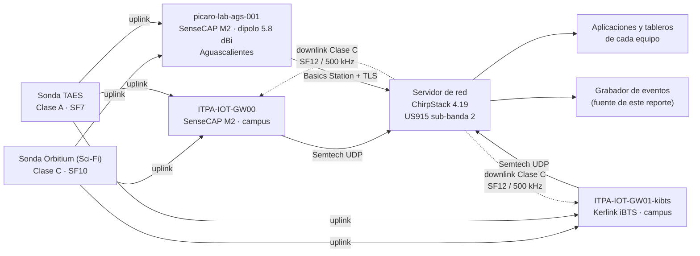

Cualquier gateway puede recibir un uplink, y el servidor elimina las copias repetidas. Basta con que un gateway oiga a la sonda para que el paquete llegue. Un **grabador** suscrito al servidor guardó todos los eventos de las aplicaciones de las dos sondas: uplinks, joins, downlinks, confirmaciones de transmisión y avisos. Ese registro es la base de este reporte.

**Salud de la red.** Los tres gateways recibieron tráfico todos los días entre el 27-oct y el 2-nov. El día UTC del vuelo fue el de más paquetes de las dos semanas en los tres. Durante la noche hubo 80 intervalos de 5 min con tráfico de alguna sonda: GW00 la oyó en los **80**, GW01-kibts en **79** y el laboratorio en **11**, siempre con las sondas en altura.

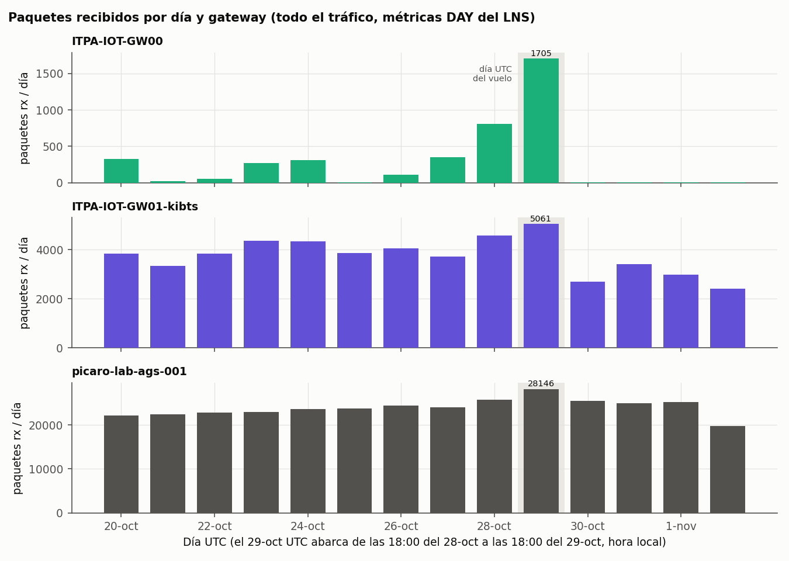

*Figura 1. Paquetes recibidos por día UTC, según las métricas del servidor. Cuentan todo lo que oye cada gateway, no solo las sondas. El 2-nov está incompleto porque es el día de la extracción.*

---

## Perfil de vuelo y atmósfera

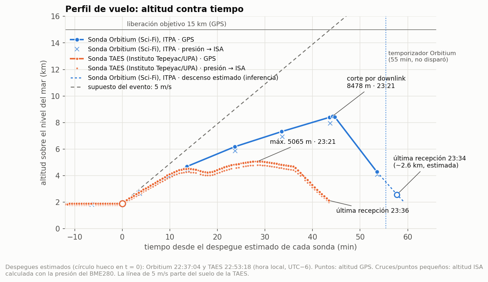

*Figura 2. Altitud GPS de las dos sondas a lo largo del tiempo.*

### a) Sonda Orbitium (Sci-Fi), del Instituto Tecnológico de Pabellón de Arteaga (ITPA)

**Ascenso.** Subió a unos 4.1 m/s en los primeros ~3.5 min, del despegue a su primer fix en el aire (2764 m a las 22:40:38), y luego fue frenando: 3.19, 2.47, 1.93 y 1.78 m/s en tramos de unos 10 min. Del despegue a la altitud máxima promedió **2.49 m/s**. Que frenara de forma sostenida apunta a una pérdida de sustentación del globo: fuga, helio enfriándose de noche o un llenado bajo (**inferencia**). No hay registro del llenado ni de la sustentación del globo para comprobarlo.

#### Los 8478 m de Orbitium son reales

1. **La serie GPS es coherente.** Marcó 8390 m, 40 s después 8478 m y luego 8408 m, ya en caída.
2. **Dos GPS distintos coinciden.** A la misma presión, la altitud GPS de Orbitium y la de TAES difieren solo **11 y 17 m** (a 733.6 y 580.2 hPa).
3. **La presión cuadra.** Con el perfil de temperatura virtual estimado con TAES (hipsometría), la ecuación hipsométrica da **8382 m** a 359.6 hPa. El GPS da **8412 m** en ese momento.

**Veredicto:** 8478 m GPS, con una incertidumbre estimada de **±50-100 m** (**inferencia**).

#### El único dato por encima de 5.4 km

- **Viento.** Con fixes cada 10 min, su deriva da vientos promedio de capas de 1-2 km: **7.2 m/s del S** entre 2.8 y 4.7 km, **12.2 m/s del SO** entre 4.7 y 6.2 km, **11.3 m/s del SO** entre 6.2 y 7.3 km y **12.8 m/s del OSO** entre 7.3 y 8.4 km ([`datos/derivados/a2_viento_capas.csv`](datos/derivados/a2_viento_capas.csv)). Derivó **31.6 km hacia el NE** hasta su último fix.
- **Temperatura virtual.** Sus capas, de 1-2 km entre pares de fixes, llevan errores de ±4 a ±10 K. En la más alta, a 7.3-8.4 km, salió **−14.3 ± 7.2 °C**, frente a −36.2 °C de la ISA (+22 ± 7 K) ([`datos/derivados/a2_temperatura_capas.csv`](datos/derivados/a2_temperatura_capas.csv)). Por la atmósfera cálida, la altitud ISA se quedó **482 m** corta frente al GPS a 8412 m (77 m en tierra).
- **Sensores de la cápsula.** Marcaron 18 °C a 8.4 km, donde el ajuste del perfil de temperatura virtual da unos −23 °C, y en vuelo no bajaron de **+15.5 °C**. La humedad pegada en 100 %, señal de un BME280 dañado por un cableado erróneo, aparece en 24 lecturas, todas del 27-oct: **ninguna es del vuelo**. Orbitium **no transmitió datos de batería** en todo el registro.

### b) Sonda TAES, del Instituto Tepeyac y la Universidad Politécnica de Aguascalientes (UPA)

Con un fix cada ~30 s (**82 fixes válidos en vuelo**), TAES dejó el perfil vertical más fino de la noche. De él salen el perfil de viento, la temperatura virtual con menor incertidumbre y la referencia con la que se validó la altitud de Orbitium.

**Ascenso.** Subió a **3.57 m/s** hasta 4345 m (4.7 m/s entre sus dos primeros fixes). Se estancó a 4.4-4.5 km unos 6 min y bajó ~190 m. Después volvió a subir, a 1.3 m/s de media, hasta **5065 m**, y empezó a perder altura despacio (−0.9 m/s). Del suelo a la altitud máxima promedió 1.86 m/s. Su cadencia permite seguir la velocidad vertical con una regresión móvil de ±60 s, y por eso su corte por tiempo se distingue en el perfil (ver [Cómo terminó cada vuelo](#cómo-terminó-cada-vuelo)).

#### Perfil de viento

| Capa | Subida | Bajada |
|---|---|---|
| 1.9-2.4 km | 5.1 m/s del ESE | — |
| 2.4-2.9 km | 4.9 m/s del SSE | 4.6 m/s del SE |
| 2.9-3.4 km | 4.0 m/s del SSE | 4.3 m/s del SSE |
| 3.4-3.9 km | 7.4 m/s del S | 8.8 m/s del S |
| 3.9-4.4 km | 10.4 m/s del S | — |
| 4.4-4.9 km | 11.7 m/s del SSO | 13.2 m/s del SSO |
| 4.9-5.4 km | 14.1 m/s del SSO | **14.3 m/s** del SSO |

*Fuente: [`datos/derivados/a2_viento_capas.csv`](datos/derivados/a2_viento_capas.csv). Viento medio por capa de 500 m, estimado con la deriva del globo (método del globo piloto).*

El viento venía del sur, giraba al suroeste con la altura y se hacía más fuerte. **El campo de viento fue estable:** la subida y la bajada, separadas unos 30 min, coinciden en cada capa. TAES derivó **24.8 km hacia el NNE** hasta su último fix.

#### Temperatura virtual con la menor incertidumbre

- **Capas de 500 m con un error de ±0.4 a ±1.2 K entre 2.5 y 5 km.** En ese tramo, la temperatura virtual iba unos **15-17 K por encima de la ISA**. A 4.5-5 km se estimaron **+0.1 ± 0.4 °C**, frente a −15.8 °C de la ISA ([`datos/derivados/a2_temperatura_capas.csv`](datos/derivados/a2_temperatura_capas.csv)).
- **Su GPS es consistente consigo mismo.** A la misma presión, la altitud de la bajada y la de la subida difieren una mediana de −2 m (29 pares, de −5 a +7 m) ([`datos/derivados/a2_resumen.txt`](datos/derivados/a2_resumen.txt)).
- **La altitud ISA se quedó corta** frente al GPS: 103 m en tierra y **275 m** a 5065 m.
- **Sensores de la cápsula.** El de temperatura nunca bajó de **+9.9 °C**. La batería bajó de 4.038 a **4.016 V**, lejos del umbral de 3.3 V. No hay ninguna lectura de humedad pegada en 100 %.

### c) Comparación

#### Subieron más despacio de lo previsto

- **El diseño del evento suponía ~5 m/s.** Contando desde el suelo del campus (~1.9 km), a 5 m/s se llega a 15 km en **~44 min**, y a 4 m/s, en **~55 min**. A 2.49 m/s, Orbitium habría necesitado **~88 min**.
- **Consecuencia para el criterio de liberación (inferencia).** Con esos ascensos, el umbral de 15 km quedaba fuera de alcance. Incluso a 4 m/s sostenidos, los 15 km llegaban justo al vencer el temporizador de 55 min. El único disparador posible era el tiempo: el temporizador de 55 min de Orbitium habría liberado a ~10 km o menos, y el corte por tiempo de TAES actuó a los ~36 min, a ~4.7 km.

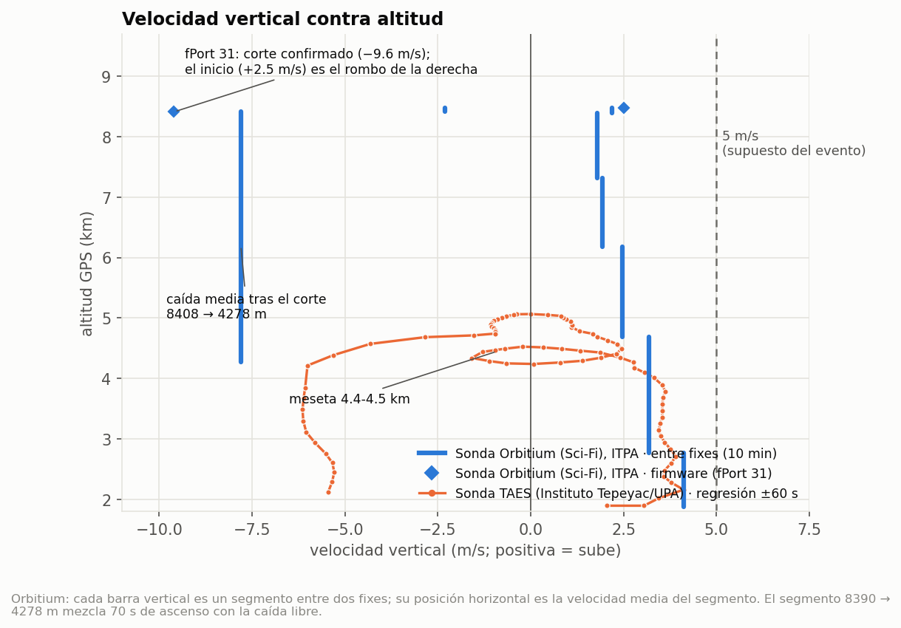

*Figura 3. Velocidad vertical. En TAES es una regresión móvil de ±60 s. En Orbitium es la diferencia entre fixes, que llegan cada ~10 min; el primer tramo va del despegue estimado al primer fix en el aire.*

#### Viento y deriva

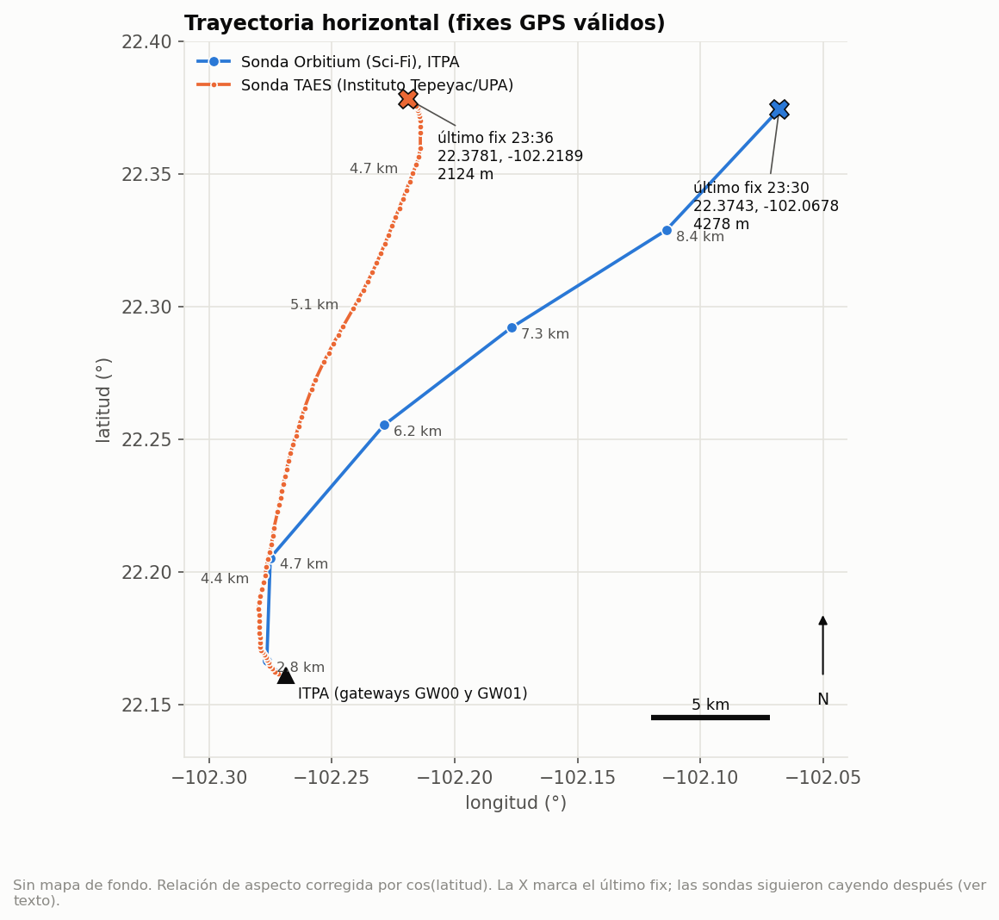

*Figura 4. Trayectoria horizontal de las dos sondas desde el campus.*

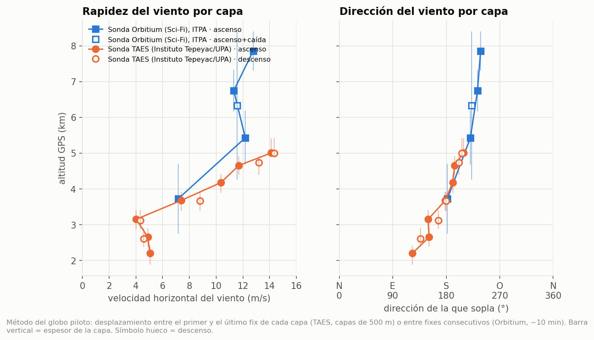

*Figura 5. Viento medio por capa de las dos sondas, estimado con la deriva del globo (método del globo piloto).*

| Capa | Viento | Fuente |
|---|---|---|
| por debajo de 3.4 km | 4-5 m/s del SE-SSE | TAES |
| 3.4-4.4 km | 7-10 m/s del S | TAES (Orbitium: 7.2 m/s del S entre 2.8 y 4.7 km) |
| 4.4-5.4 km | 12-14 m/s del SSO | TAES |
| 4.7-8.4 km | 11-13 m/s del SO-OSO | Orbitium |

Las dos sondas describen el mismo patrón: viento del sur que gira al suroeste con la altura y se hace más fuerte. Orbitium derivó **31.6 km hacia el NE** y TAES **24.8 km hacia el NNE**.

#### Una atmósfera cálida y sensores dentro de la cápsula

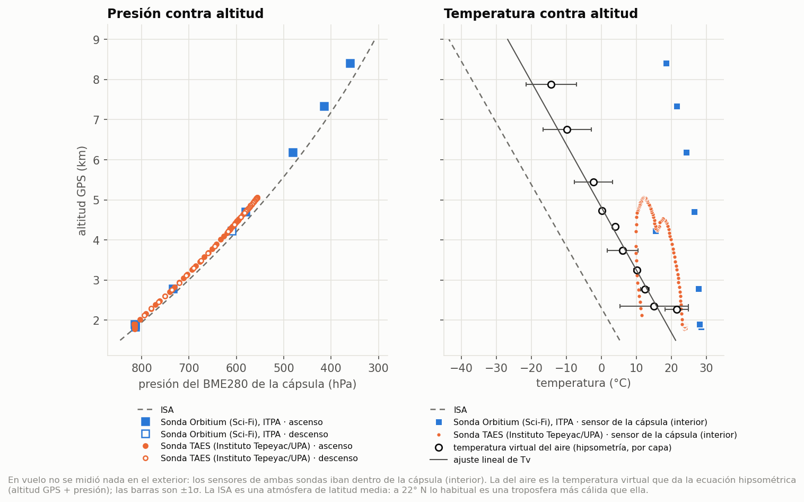

*Figura 6. Izquierda: presión medida contra altitud GPS, comparada con la ISA. Derecha: temperatura virtual del aire estimada por hipsometría (con barras de ±1σ) y temperatura del sensor de la cápsula (interior).*

**En vuelo no se midió nada en el exterior.** Los sensores de temperatura, humedad y presión de las dos sondas iban dentro de la cápsula. La temperatura del aire solo se estima de forma indirecta: la ecuación hipsométrica, con la presión de la cápsula (que no era estanca, así que su presión sigue a la del aire) y la altitud GPS, da la **temperatura virtual** media de cada capa. No es la temperatura del aire: con aire húmedo, la virtual sale algo más alta. Son **estimaciones**:

- **Las dos sondas coinciden en una troposfera cálida**: unos 15-17 K sobre la ISA entre 2.5 y 5 km con TAES, y +22 ± 7 K a 7.3-8.4 km con Orbitium.
- **No es una anomalía de esa noche.** La ISA representa una atmósfera de latitud media. A 22° N, lo esperable es una troposfera más cálida que la ISA. Para saber si esa noche fue normal, hay que compararla con un radiosondeo oficial ([D3](#recomendaciones-para-satlink-2027-resumen)).
- **Por eso la altitud ISA se quedó corta frente al GPS**: entre **77 y 103 m** en tierra, **275 m** a 5065 m y **482 m** a 8412 m.
- **Los sensores miden la cápsula, no el aire.** Orbitium marcó 18 °C a 8.4 km, donde el ajuste del perfil de temperatura virtual da unos −23 °C. La humedad que reportan las dos es también la del interior de la cápsula. Ver la [figura de humedad](figuras/a2_humedad.png).

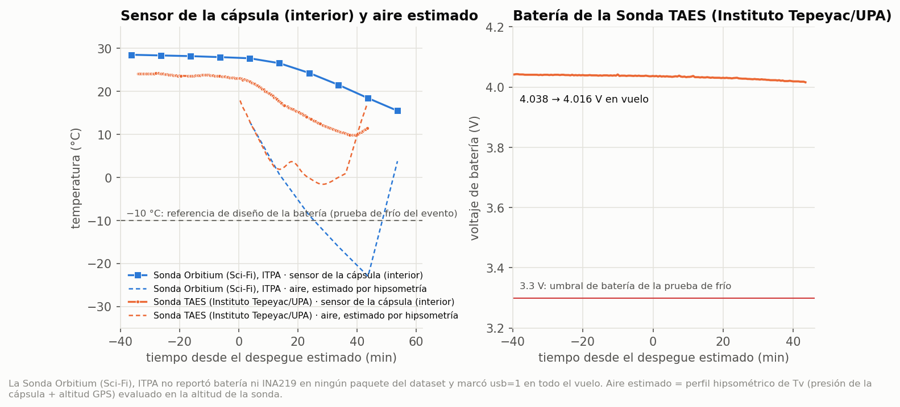

*Figura 7. Temperatura del sensor de cada cápsula y voltaje de la batería de TAES, frente a la referencia de la prueba de frío del evento.*

**El frío fue mucho más suave que el de la prueba de frío** que pide el evento (90 min a −40 °C). El sensor de la cápsula nunca bajó de **+9.9 °C** (TAES) ni de **+15.5 °C** (Orbitium). La batería de TAES se mantuvo lejos del umbral de 3.3 V; Orbitium **no transmitió datos de batería** en todo el registro.

---

## Cómo terminó cada vuelo

### a) Sonda Orbitium (Sci-Fi), del Instituto Tecnológico de Pabellón de Arteaga (ITPA)

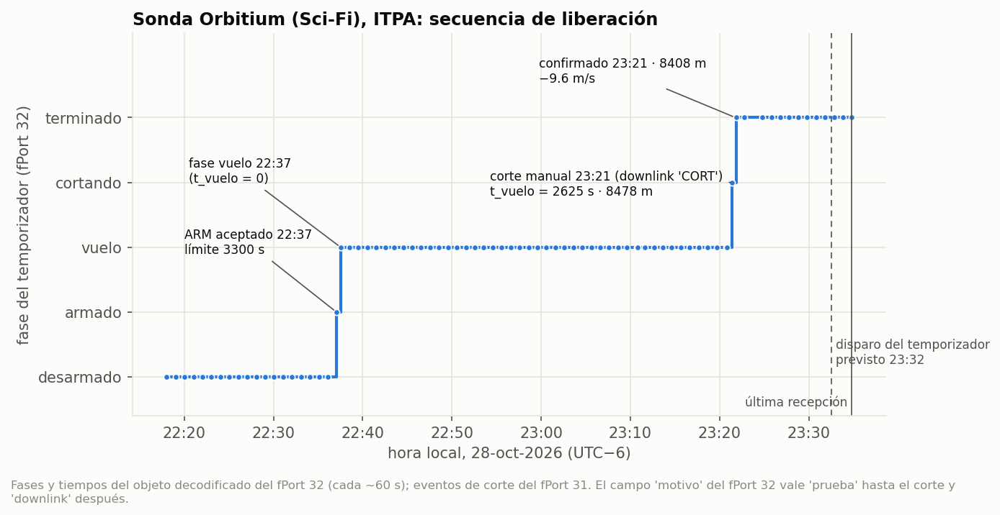

*Figura 8. Eventos del temporizador (fPort 32) y del corte (fPort 31) de la Sonda Orbitium (Sci-Fi), sobre su perfil de altitud.*

**Corte por orden de radio.** El firmware registró esta secuencia:

| Hora | Evento |
|---|---|
| 22:37:02 | Armado aceptado del temporizador, con límite de 3300 s |
| 22:37:30 | Inicio de la fase de vuelo |
| 23:21:16 | Inicio del corte por downlink, a 8478 m y con t_vuelo = 2625 s |
| 23:21:46 | Corte confirmado a 8408 m, cayendo a −9.6 m/s |

El temporizador habría disparado a las 23:32:30, **674 s después**. La sonda cayó a **7.8 m/s** de media hasta su último fix, a 4278 m a las 23:30:36. Escalada con la densidad, esa velocidad equivale a 6.3 m/s a 2 km, un valor típico de un descenso en paracaídas. Es coherente con un paracaídas abierto (**inferencia**). Los datos no dicen quién ordenó el corte ni por qué. Su última recepción llegó a ~2.6 km de altitud, según el modelo de descenso (**inferencia**).

#### Orbitium en tierra: telemetría contra el punto de recuperación

Al día siguiente, el 29 de octubre, habitantes de la comunidad de **El Rascón, Zacatecas**, encontraron la cápsula de Orbitium y la reportaron. Así se pudo recuperar. El punto del hallazgo (**22.3778, −102.0594**, terreno a 2040 m según SRTM) permite contrastar lo que dijo la telemetría ([`datos/recuperacion.csv`](datos/recuperacion.csv)):

| Referencia | Distancia al punto de recuperación | Rumbo |
|---|---|---|
| Último fix GPS (23:30:36, 4278 m) | **942 m** | 66° (ENE) |
| Fix de altitud máxima con posición (23:20:36, 8390 m) | 7.8 km | 46° (NE) |
| ITPA-IOT-GW00, en el campus | 32.3 km | 42° (NE) |
| Zona estimada de aterrizaje del análisis de vuelo (22.39, −102.07) | **1.74 km de error** | — |

- **El último fix ya ubicaba la cápsula a menos de 1 km.** Con una posición cada 10 min, la telemetría bastó para buscar en el área correcta, aunque la señal se perdió unos 500 m antes de tocar tierra.
- **El descenso cuadra con el modelo.** Con el terreno a 2040 m, el modelo de velocidad terminal pone el aterrizaje hacia las **23:36:13**. Eso da unos 340 s desde el último fix y una caída media de **6.6 m/s**, dentro de los 5-8 m/s que pide el evento (**cálculo**; la hora de aterrizaje no se midió).
- **La deriva final no siguió el viento de la otra sonda.** La estimación previa usaba el viento que midió TAES en su descenso, unos 15 km al oeste, y predecía unos 1.8 km hacia el NNO. En realidad, la cápsula avanzó 942 m hacia el ENE: un viento medio de **~2.8 m/s del OSO** por debajo de 4.3 km, donde TAES medía viento del S-SE (**inferencia**). Fue la mayor fuente de error de la predicción: en capas bajas, el viento cambia en pocos kilómetros, y un pronóstico de aterrizaje con datos de otra sonda erró por más de 1.5 km.
- **Limitaciones.** Es la posición del hallazgo, no la del impacto, y se supone que nadie movió la cápsula.

#### Lo que declaró el equipo frente a lo que se midió

El Equipo Orbitium (Sci-Fi) declaró estos datos de su cápsula. Así se comparan con lo que registró la red:

| Aspecto | Declarado por el equipo | Medido en vuelo |
|---|---|---|
| Electrónica | Heltec WiFi LoRa 32 V3 (ESP32-S3 + SX1262), GPS, BME280 y OLED, sobre protoboard | Coincide: GPS y BME280 reportaron todo el vuelo, y el SX1262 cerró el enlace hasta ~50 km |
| Estructura | Caja de XPS de 23 cm sellada con RTV, patas anguladas y bahía superior para el paracaídas | Cápsula íntegra y recuperada; los datos no permiten evaluar el impacto |
| Masa del tren de vuelo | **616.1 g** (paracaídas y herrajes, 196.1 g); límite de 750 g | Descenso de **6.3 m/s** equivalentes a 2 km (modelo) y **6.6 m/s** de media en el tramo final |
| Prueba de frío | Prueba en cámara con hielo seco a **−26 °C** (temperatura de la cámara), sin cortes de alimentación según el equipo. El equipo no reportó la temperatura interior alcanzada | En vuelo, el sensor de la cápsula no bajó de **+15.5 °C**; el vuelo no pasó de 8.5 km |
| Prueba de caída | 10 m en 2.5 s, sin daños | No es comparable con el descenso con paracaídas: en 10 m el paracaídas apenas se despliega |
| Potencia de TX y antena | No se declararon | Siguen siendo la principal incógnita del análisis de enlace |

Los datos declarados confirman el hardware que se supuso en el análisis, pero no cierran la incógnita de potencia y antena. Para 2027 conviene pedir esos dos datos a cada equipo (S1 y E3 del [resumen de recomendaciones](#recomendaciones-para-satlink-2027-resumen)).

### b) Sonda TAES, del Instituto Tepeyac y la Universidad Politécnica de Aguascalientes (UPA)

**Corte por tiempo.** A las **23:29:30**, a ~**4.7 km**, pasó de −0.9 m/s a **−5.8 m/s**. Ese cambio coincide con el corte por tiempo de su propio sistema, unos **36 min** después de su despegue estimado (22:53:18, [`datos/vuelos.csv`](datos/vuelos.csv)). Escalada con la densidad, la nueva velocidad equivale a 5.4 m/s a 2 km, la firma de un descenso en paracaídas. Su paquete no trae un campo de liberación (el byte de banderas vale 159 todo el vuelo), así que el corte no aparece en la telemetría: se ve en el perfil de velocidad, con la resolución de sus fixes cada 30 s.

**Su señal se siguió casi hasta el suelo.** La última recepción llegó con la sonda a 2124 m, entre ~20 y ~220 m sobre el terreno según el punto exacto. De la Sonda TAES no hay punto de recuperación en este reporte.

### c) Comparación

| | Orbitium | TAES |
|---|---|---|
| Disparador | orden de radio (CORT) | tiempo, de su propio sistema |
| Hora y altitud del corte | 23:21:16, a 8478 m | ~23:29:30, a ~4.7 km |
| Registro del corte | fPort 31, segundo a segundo | solo en el perfil de velocidad (resolución de 30 s) |
| Descenso, equivalente a 2 km | 6.3 m/s | 5.4 m/s |
| Última señal | ~2.6 km de altitud (modelo) | 2124 m, a ~20-220 m del terreno |
| Punto de recuperación | El Rascón, Zacatecas, a 942 m del último fix | no hay en este reporte |

**Las dos señales se perdieron antes de aterrizar.** Las dos velocidades de descenso son coherentes con un paracaídas abierto (**inferencia**).

---

## Enlace y desempeño de los gateways

### a) Sonda Orbitium (Sci-Fi), del Instituto Tecnológico de Pabellón de Arteaga (ITPA)

- **La red recibió el 95.9 % de sus 98 uplinks de vuelo**, en SF10: el 90.8 % por ITPA-IOT-GW00, el 84.7 % por ITPA-IOT-GW01-kibts y el 57.1 % por el laboratorio. 9 llegaron por un solo gateway, 36 por dos y 49 por los tres.
- **Margen de SNR mediano:** 14.8 dB en GW00, 8.0 dB en GW01-kibts y 5.0 dB en el laboratorio.
- **La distancia máxima la fijó el fin de los datos, no el enlace.** El último fix de Orbitium, a 31.6 km de los gateways del campus, todavía llegó con 6.8 dB de margen. Al laboratorio llegó a unos 50 km.
- **Pérdida en exceso sobre el espacio libre:** 45.4 dB (GW00) y 49.9 dB (GW01-kibts) de mediana con la sonda en el suelo, a ~110-150 m, y 36.6 dB de mediana en el laboratorio durante el vuelo ([`datos/derivados/a1_resumen.json`](datos/derivados/a1_resumen.json)).
- **Paquetes cortos para SF10.** Cada uplink de 11 B tarda 370.7 ms en el aire. Con 27 B, SF10 tardaría 534.5 ms y rebasaría el límite de 400 ms por canal. Por eso Orbitium manda 11 B.

#### La bajada fue el enlace más frágil

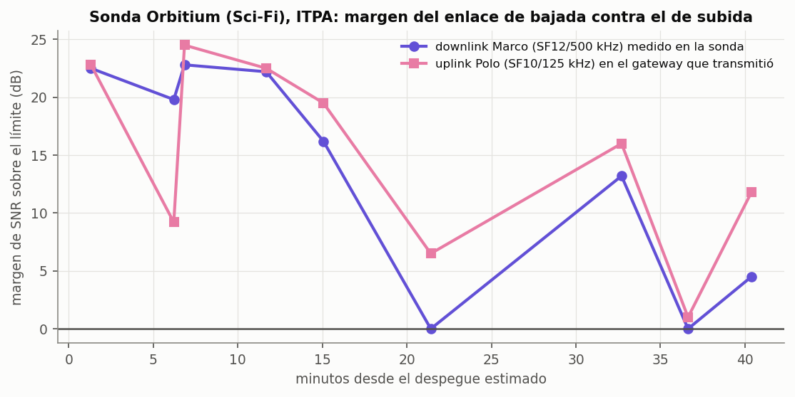

*Figura 9. Margen de SNR del Marco medido en la sonda (SF12/500 kHz) y del Polo de respuesta en el gateway que transmitió (SF10/125 kHz).*

Orbitium era la única sonda en Clase C. Los comandos salieron en 923.3 MHz, con SF12, 500 kHz y 21 dBm. Orbitium reporta en cada Polo cómo recibió el Marco, así que el margen se midió **en la propia sonda**. Bajó de 22.8 a **0.0 dB**, y llegó a cero dos veces:

| Momento (desde el despegue estimado) | Hora | Distancia oblicua | Altitud (interpolada) |
|---|---|---|---|
| T+21.4 min | 22:58:29 | 10.6 km | ~5.8 km |
| T+36.6 min | 23:13:42 | 20.4 km | ~7.7 km |

*Fuente: [`datos/derivados/a1_downlinks_margen.csv`](datos/derivados/a1_downlinks_margen.csv) y [`datos/recepciones.csv`](datos/recepciones.csv) (fCnt 1065 y 1093).*

**Salvedad:** los dos valores son exactamente −20.00 dB, y entre los demás no hay ninguno entre −15.5 y −20 dB. Puede que −20 dB sea un piso de lo que reporta la radio o de su procesamiento, y no una medida en el límite. El firmware codifica el SNR en el Polo con un rango de −32 a +31.75 dB, así que no lo recorta el payload, pero no se pudo confirmar en la radio. Lo correcto es leerlo como **SNR ≤ −20 dB según la radio: margen ≤ 0 dB, o desconocido**.

Las dos veces coincidieron con los peores momentos de la subida. Eso apunta a la orientación de la cápsula y al patrón de las antenas (**inferencia**).

### b) Sonda TAES, del Instituto Tepeyac y la Universidad Politécnica de Aguascalientes (UPA)

- **La red recibió el 94.3 % de sus 87 uplinks de vuelo**, en SF7: el 87.4 % por ITPA-IOT-GW00, el 79.3 % por ITPA-IOT-GW01-kibts y el 21.8 % por el laboratorio. 16 llegaron por un solo gateway, 50 por dos y 16 por los tres.
- **Margen de SNR mediano:** 13.5 dB en GW00, 7.5 dB en GW01-kibts y 2.0 dB en el laboratorio.
- **Llegó a 24.7 km del campus y a unos 51 km del laboratorio.** A 24.7 km, con la sonda a 2.1-2.3 km de altitud, su señal todavía llegaba al campus con 8.5 a 11.5 dB de margen.
- **Pérdida en exceso sobre el espacio libre:** 37.7 dB (GW00) y 42.6 dB (GW01-kibts) de mediana con la sonda en el suelo, a ~100-155 m, y 31.2 dB de mediana en el laboratorio durante el vuelo ([`datos/derivados/a1_resumen.json`](datos/derivados/a1_resumen.json)).
- **SF7 deja espacio para una cadencia alta.** Cada uplink de 27 B tarda 82.2 ms en el aire, lo que le permitió mandar un fix cada ~30 s sin acercarse al límite de 400 ms por canal. A cambio, tiene 7.5 dB menos de sensibilidad teórica que SF10: en el laboratorio, con la sonda a 3.5-5.5 km, llegaron 14 de sus 59 uplinks (24 %).

### c) Comparación

#### Cuánto llegó y por dónde

| Uplinks en vuelo | Orbitium, SF10 | TAES, SF7 |
|---|---|---|
| fCnt esperados | 98 | 87 |
| Recibidos por ITPA-IOT-GW00 | 90.8 % | 87.4 % |
| Recibidos por ITPA-IOT-GW01-kibts | 84.7 % | 79.3 % |
| Recibidos por picaro-lab-ags-001 | 57.1 % | 21.8 % |
| **Red completa** | **95.9 %** | **94.3 %** |
| Recibidos por 1 / 2 / 3 gateways | 9 / 36 / 49 | 16 / 50 / 16 |
| Margen de SNR mediano (GW00 / GW01 / laboratorio) | 14.8 / 8.0 / 5.0 dB | 13.5 / 7.5 / 2.0 dB |
| Distancia oblicua máxima con recepción (campus / laboratorio) | 31.6 / ~50 km | 24.7 / ~51 km |

*Fuente: [`datos/derivados/a1_por_gateway.csv`](datos/derivados/a1_por_gateway.csv) y [`datos/derivados/a1_resumen.json`](datos/derivados/a1_resumen.json). El vuelo cuenta desde el despegue estimado. Margen de SNR = SNR medido − límite de demodulación del SF (−15 dB en SF10, −7.5 dB en SF7). Las distancias al laboratorio llevan un error de hasta ~2 km por el tratamiento de privacidad de su posición. Se excluyen las posiciones interpoladas que cruzan el corte de Orbitium (`usar_geometria = 0`).*

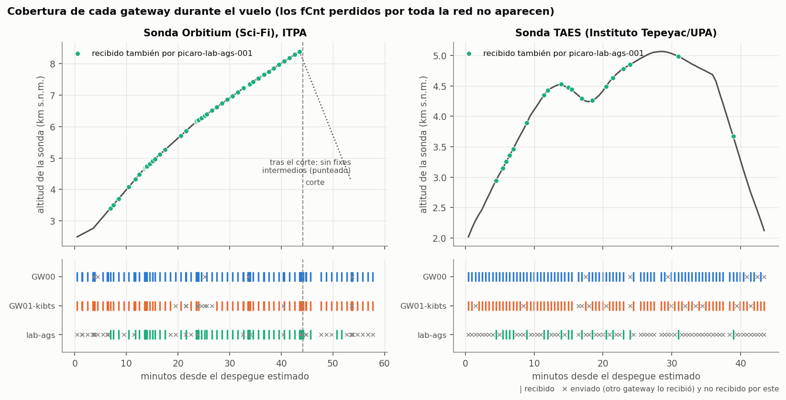

*Figura 10. Arriba: altitud de cada sonda; en verde, los uplinks que también recibió el laboratorio. Abajo: uplinks que recibió cada gateway (|) y los que recibió otro gateway pero no ese (×).*

- **ITPA-IOT-GW00 fue el mejor receptor** con las dos sondas.
- **ITPA-IOT-GW01-kibts entregó 6-8 puntos menos y tuvo ~6-7 dB menos de SNR mediano**, aunque está a menos de 100 m, su antena tiene más ganancia nominal y está 10 m más alta. La desventaja aparece ya a baja elevación. Eso apunta a la instalación (cable, conectores o ruido del sitio) más que al patrón de la antena (**inferencia**).

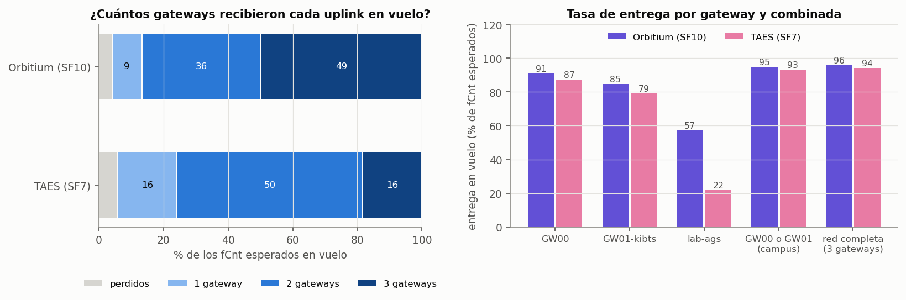

*Figura 11. Uplinks del vuelo según cuántos gateways los recibieron, y entrega de cada gateway frente a la de la red combinada.*

El segundo gateway del campus aportó casi toda la ganancia de diversidad: +4 y +6 puntos. El laboratorio salvó solo 1 uplink de cada sonda, pero es el único que ve a las sondas de lejos y con poca elevación. Es la geometría que tendrán los vuelos más largos.

#### El margen real fue mucho menor que el previsto

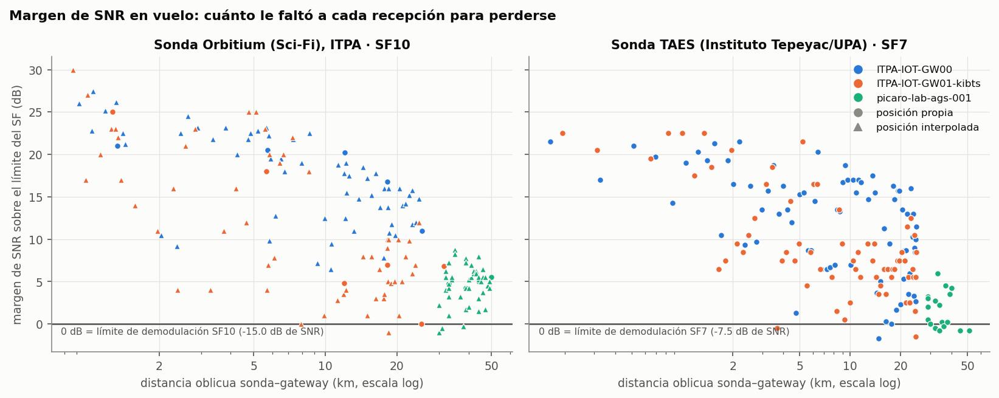

*Figura 12. Margen de SNR de cada recepción en vuelo contra la distancia oblicua. El cero es el límite de demodulación.*

El presupuesto de enlace previo al vuelo suponía 22 dBm de TX, 5 dBi por extremo, 1 dB de cable por extremo y 3 dB de margen por patrón. En el laboratorio, la antena real es un dipolo RAIGEN de **5.8 dBi**, 0.8 dB más que el supuesto, y este reporte la usa: eso sube en 0.8 dB su margen previsto y **aumenta en 0.8 dB su pérdida en exceso estimada**. A las distancias reales, el presupuesto preveía un **margen mediano de 29.5 a 49 dB**. El margen de SNR medido fue de **2 a 17 dB**, es decir, **entre 26 y 40 dB menos**.

- **El enlace cerró, pero varias recepciones llegaron en el límite** de demodulación o algo por debajo, hasta −2 dB.
- **El déficit no es propio del vuelo: también aparece en tierra.** Con la sonda en el suelo, a 100-155 m de los gateways del campus, la pérdida en exceso sobre el espacio libre fue de **38 a 50 dB** ([`datos/derivados/a1_resumen.json`](datos/derivados/a1_resumen.json), `exceso_suelo`). En vuelo, incluso a menos de 10° de elevación, donde menos debería pesar el patrón de las antenas, fue de **23 a 25 dB** (`nulo_cenital`), y crece con la elevación. En el laboratorio, ya con su ganancia real, la pérdida en exceso mediana fue de **36.6 dB** con Orbitium y **31.2 dB** con TAES (`presupuesto.ajuste`). Apunta a un faltante sistemático de **al menos ~23 dB** respecto a los supuestos (**inferencia**). Sus causas no se pueden separar, porque no se midieron ni la potencia de TX ni la ganancia de antena de las sondas.

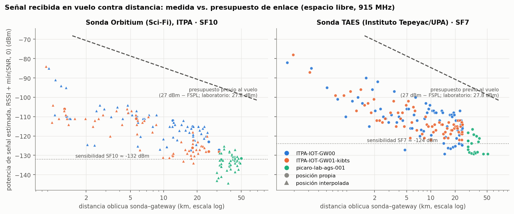

*Figura 13. Señal estimada contra la distancia oblicua, en escala logarítmica. La línea discontinua es el presupuesto de enlace previo al vuelo (27 dBm − FSPL; en el laboratorio, con su antena de 5.8 dBi, es 0.8 dB más alto).*

#### ¿Nulo cenital? Evidencia solo indirecta

Los supuestos previos al vuelo advertían que la colineal del Kerlink tiene un nulo cerca del cenit. Para comprobarlo, se comparó la señal de los dos gateways del campus **en el mismo uplink** ([`datos/derivados/a1_nulo_cenital.csv`](datos/derivados/a1_nulo_cenital.csv)):

- La pérdida en exceso **crece con la elevación** en los dos gateways: ~23-25 dB por debajo de 10° y 36-39 dB por encima de 35°. Es compatible con nulos cenitales en los dos extremos del enlace. Pero la elevación, la distancia y el tiempo de vuelo van juntos, así que es una **inferencia**.
- **No aparece un efecto propio del Kerlink.** La diferencia GW01 − GW00 es de −1 dB cerca del horizonte, −8 dB a 10-20° y −2 dB en la banda más alta. La correlación con la elevación es débil (r = 0.15).
- **La elevación nunca pasó de 53.3°** (52.6° en los uplinks que recibieron los dos gateways del campus), así que no se puede concluir nada sobre el cenit.

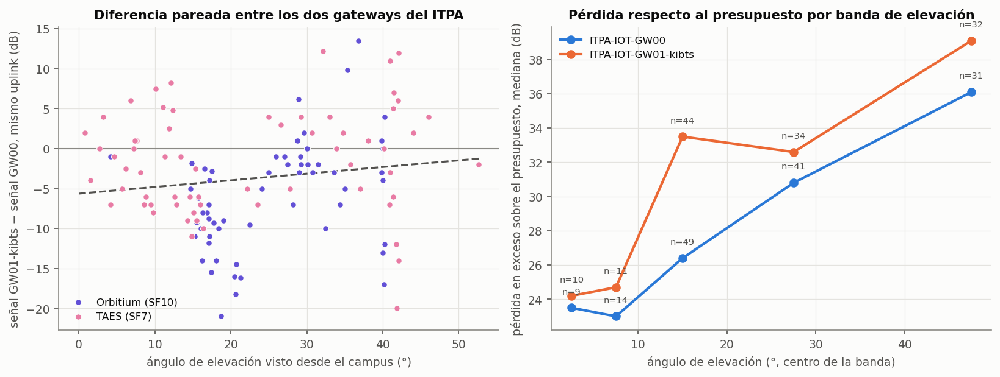

*Figura 14. Izquierda: diferencia de señal GW01-kibts − GW00 en el mismo uplink, contra la elevación. Derecha: mediana de la pérdida en exceso por banda de elevación.*

#### SF10 contra SF7

| | Orbitium · SF10 | TAES · SF7 |
|---|---|---|
| Tiempo en el aire por uplink | 370.7 ms (11 B) | 82.2 ms (27 B) |
| Margen a la misma distancia | entre +2.5 y +9.5 dB más | — |
| Recepción en el laboratorio con la sonda a 3.5-5.5 km | **15 de 18 (83 %)** | **14 de 59 (24 %)** |

**Inferencia:** SF10 parece haber marcado la diferencia en el **borde del enlace**, en el laboratorio. Pero la comparación mezcla SF, hardware, antena y trayectoria: son sondas distintas, sin potencia de TX ni antena medidas, con orientaciones y trayectorias distintas, y la altitud de Orbitium en esa banda es interpolada entre fixes de cada 10 min. La ganancia teórica de SF10 sobre SF7 es de 7.5 dB, y la diferencia de margen medida a la misma distancia (+2.5 a +9.5 dB) no la reproduce, lo que también apunta a diferencias de equipo. A cambio, cada paquete en SF10 ocupa unas 4.5 veces más tiempo en el aire, y SF7 es el que permite la cadencia de ~30 s de TAES.

**El laboratorio nunca recibió nada con las sondas por debajo de ~2.9-3.4 km.** El horizonte de radio no lo explica. Lo más probable es que el terreno entre Aguascalientes y Pabellón de Arteaga bloquee el trayecto (**inferencia**: no se hizo un perfil de terreno).

---

## Operaciones y comandos

### a) Sonda Orbitium (Sci-Fi), del Instituto Tecnológico de Pabellón de Arteaga (ITPA)

- **Sesión estable desde temprano.** Abrió a las 10:40:30 la sesión LoRaWAN con la que voló, **11.9 h antes** del despegue, y no volvió a unirse a la red.
- **Huecos de la tarde.** De 17:39 a 18:01 tuvo 5 huecos de 2 a 4.5 min, con uplinks fuera de orden y en ráfagas que solo oyó GW00. **La causa no se puede determinar.**
- **Despegue.** Aceptó el armado del temporizador a las 22:37:02; el despegue estimado es a las 22:37:04, y su firmware lo detectó a las 22:37:30.
- **Corte.** La orden se encoló a las 23:21:14 y el corte empezó a las 23:21:16. Su última señal llegó a las 23:34:49.

#### Fase 2: los comandos de Orbitium

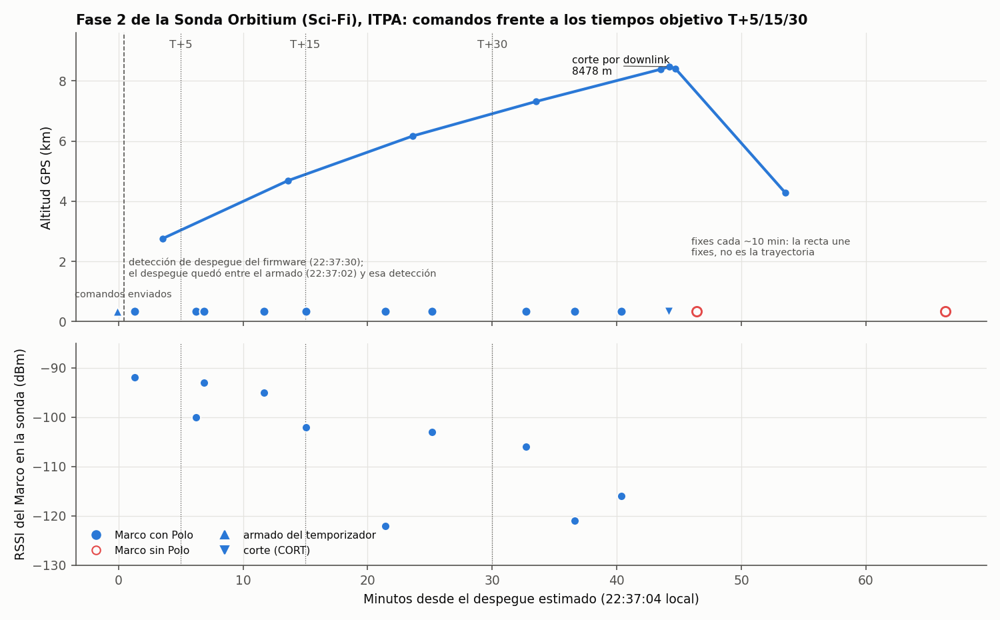

*Figura 15. Arriba: altitud y comandos enviados. Abajo: RSSI del Marco medido en la sonda. Las líneas punteadas marcan los tiempos objetivo T+5, T+15 y T+30. El eje cuenta desde el despegue estimado (22:37:04). La línea discontinua es la detección de despegue del firmware (22:37:30); el despegue quedó entre el armado (22:37:02) y esa detección.*

| Downlinks del 27 y el 28-oct | Total | Con respuesta |
|---|---|---|
| Marco (Marco Polo) | 26 | 24 |
| Prueba de corte (TEST) | 20 | 20 |
| Corte (CORT) | 3 | 3 |
| Armado del temporizador (ARM) | 1 | 1 |
| **Total** | **50** | **48 (96 %)** |

*Fuente: [`datos/downlinks.csv`](datos/downlinks.csv) y [`datos/derivados/a3_downlinks.csv`](datos/derivados/a3_downlinks.csv).*

- **Los 50 tuvieron confirmación de transmisión del gateway.** La respuesta de la sonda llegó entre 0.6 y 1.1 s después, con una **mediana de 0.8 s**. Contando desde que se encoló el comando, el ciclo completo tomó una mediana de **2.4 s**.
- **En vuelo, los 10 Marcos anteriores al corte tuvieron Polo.** Los 2 posteriores no: uno cayó en el único hueco de 120 s del vuelo, al empezar la caída, y el otro se mandó cuando ya no había señal.
- **GW00 transmitió 10 de los 13 downlinks del vuelo.** El laboratorio no transmitió ninguno. El armado del temporizador (22:37:00) se encoló antes del despegue estimado y no cuenta como downlink del vuelo.

**Tiempos de los Marcos frente a los objetivos T+5, T+15 y T+30.** La tabla da el Marco con Polo más cercano a cada objetivo, contado desde el despegue estimado. El rango refleja la incertidumbre del T0 (de 22:37:02 a 22:37:30):

| Objetivo | Marco más cercano (encolado) | Desfase | Rango por el T0 |
|---|---|---|---|
| T+5 | seq 44, 22:43:17 | +73 s | +46 a +75 s |
| T+15 | seq 47, 22:52:08 | +4 s | −23 a +6 s |
| T+30 | seq 50, 23:09:46 | +162 s | +135 a +164 s |

*Fuente: [`datos/derivados/a3_ventanas_comando.csv`](datos/derivados/a3_ventanas_comando.csv). Este reporte describe tiempos; **no evalúa** si un comando cumplió una ventana, porque para eso harían falta un T0 y una tolerancia registrados, y ninguno de los dos quedó en la red.*

Entre T+25.1 y T+32.7 min no se mandó ningún Marco. Los Marcos llevaban su número de secuencia como payload.

### b) Sonda TAES, del Instituto Tepeyac y la Universidad Politécnica de Aguascalientes (UPA)

- **Joins de la tarde.** De 18:23 a 18:44 tuvo **17 joins rechazados** (7 por MIC inválido y 10 por DevNonce ya usado) y perdió 22 min. Su primer join aceptado fue a las 18:45.
- **Fase 1.** De 19:40 a 21:41 hizo **11 re-joins**. A las 20:51 su payload pasó de 26 a 27 B: un reflasheo (**inferencia**). Desde entonces, su codec en el servidor coincide con la reinterpretación de los bytes en todos los paquetes.
- **Vuelo.** Despegó hacia las 22:53:18 y voló con una sola sesión, sin re-joins. El corte por tiempo de su sistema la separó del globo hacia las 23:29:30 (visto en el perfil de velocidad). Su última señal llegó a las 23:36:44.
- **Comandos.** Operó en Clase A y no tiene **ningún downlink** registrado en la red. Si hizo una demostración de comandos, no pasó por la red LoRaWAN del evento.

### c) Comparación

#### La noche, hora por hora

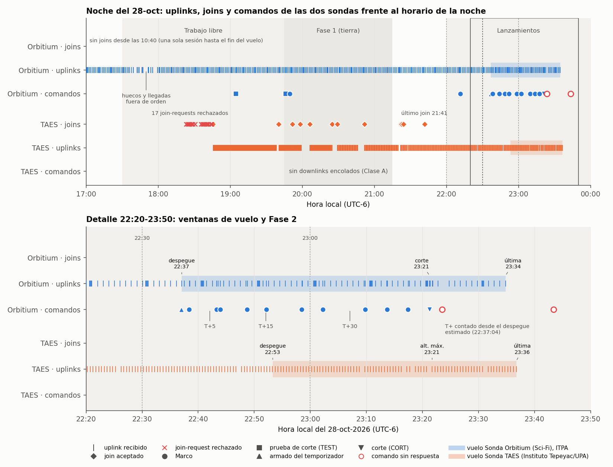

*Figura 16. Arriba: de 17:00 a 24:00, con las etapas de la noche. Abajo: detalle de 22:20 a 23:50. Cada marca es un uplink. Las bandas son la ventana de vuelo de cada sonda. Los marcadores rojos huecos son comandos sin respuesta.*

| Hora | Orbitium | TAES |
|---|---|---|
| 10:40:30 | abre la sesión con la que vuela, **11.9 h antes** del despegue | — |
| 17:39 – 18:01 | 5 huecos de 2 a 4.5 min (causa indeterminada) | — |
| 18:23 – 18:45 | — | **17 joins rechazados**; primer join aceptado a las 18:45 |
| 19:40 – 21:41 | — | **11 re-joins** en la Fase 1; a las 20:51, payload de 26 a 27 B |
| 22:37:02 – 22:37:30 | armado del temporizador (22:37:02), despegue estimado (22:37:04) y detección del firmware (22:37:30) | — |
| 22:53:18 | — | despegue estimado |
| 23:21:14 – 23:21:16 | se encola la orden de corte; el corte empieza a las 23:21:16 | — |
| 23:29:30 | — | corte por tiempo de su sistema (visto en el perfil de velocidad) |
| 23:34:49 / 23:36:44 | última señal (23:34:49) | última señal (23:36:44) |

*Fuente: [`datos/derivados/a3_cronologia_noche.csv`](datos/derivados/a3_cronologia_noche.csv), [`datos/joins.csv`](datos/joins.csv) y [`datos/eventos_red.csv`](datos/eventos_red.csv).*

**No hubo re-joins en vuelo**: cada sonda voló con una sola sesión. La diferencia estuvo antes: Orbitium llegó a la Fase 2 con una sesión de casi 12 h, y TAES, con joins rechazados y re-joins durante la Fase 1.

---

## Qué aprendimos

### a) Sonda Orbitium (Sci-Fi), del Instituto Tecnológico de Pabellón de Arteaga (ITPA)

1. **La Clase C y el Marco Polo funcionaron hasta el corte.** Los 10 Marcos de vuelo anteriores al corte tuvieron Polo, con una latencia mediana de 0.8 s. Después del corte, ningún Marco tuvo respuesta, y antes la bajada ya había llegado a SNR ≤ −20 dB a ~5.8 y ~7.7 km. Los comandos críticos van antes del corte.
2. **Un evento de liberación explícito vale oro.** El fPort 31 de Orbitium documentó el corte por radio segundo a segundo: hora, altitud, velocidad y motivo.
3. **Una sesión LoRaWAN estable desde temprano evita sorpresas.** Orbitium voló con una sesión de 11.9 h y sin re-joins.
4. **La telemetría y la comunidad hicieron posible la recuperación.** El último fix quedó a 942 m del hallazgo, y fueron los habitantes de El Rascón, Zacatecas, quienes encontraron la cápsula y la reportaron. La predicción hecha con el viento de la otra sonda erró 1.74 km.

### b) Sonda TAES, del Instituto Tepeyac y la Universidad Politécnica de Aguascalientes (UPA)

5. **Una cadencia de 30 s convierte la sonda en un perfilador.** Con 82 fixes válidos en vuelo, TAES dio el perfil de viento y la temperatura virtual con menor incertidumbre de la noche, y la referencia con la que se validaron los 8478 m de Orbitium.
6. **El corte por tiempo actuó, pero hay que reportarlo.** Su sistema cortó a los ~36 min, a ~4.7 km, pero el corte no aparece en su telemetría: solo se reconoce por el salto de −0.9 a −5.8 m/s en el perfil de velocidad, y su hora queda limitada a la cadencia de sus fixes (30 s).
7. **Los joins rechazados cuestan tiempo.** TAES perdió 22 min en 17 joins rechazados y re-joineó 11 veces en la Fase 1. Además, su codec en el servidor no decodificaba sus paquetes de 26 B, y su formato tuvo que inferirse.

### c) Comparación

8. **La red aguantó; el margen, no tanto.** El enlace cerró con un 94-96 % de entrega hasta 31.6 km del campus y unos 50 km del laboratorio, pero el margen quedó 26-40 dB por debajo del previsto. Hace falta un presupuesto de enlace con valores medidos.
9. **Tres gateways valen más que uno bueno.** La diversidad redujo la pérdida a menos de la mitad, incluso con dos gateways a menos de 100 m entre sí.
10. **SF10 con paquetes cortos parece rendir en el borde del enlace; SF7, en la cadencia (inferencia).** En el laboratorio y a la misma altitud, la sonda en SF10 entregó el 83 % de los paquetes, contra el 24 % de la de SF7. Pero son sondas, antenas y trayectorias distintas, así que la diferencia no se puede atribuir solo al SF. SF7 le permitió a TAES mandar 27 B cada ~30 s.
11. **El criterio de liberación supone un ascenso que no se dio.** Con ascensos medios de 1.9-2.5 m/s hasta la altitud máxima (y primeros tramos de 3.6-4.1 m/s), ningún globo podía llegar a 15 km antes del temporizador de 55 min. Hay que medir la sustentación en el lanzamiento.
12. **El T0 tiene que quedar registrado.** Sin una hora de lanzamiento registrada, el T0 de Orbitium solo se pudo acotar a un intervalo de 28 s con su firmware, y el de TAES, extrapolar de sus fixes.
13. **Para medir el aire hace falta un sensor afuera.** En vuelo no se midió nada en el exterior: los sensores de las dos sondas iban dentro de la cápsula, y la temperatura del aire solo se pudo estimar por hipsometría. Además, en 2026 un cableado erróneo dañó varios BME280.
14. **Una lección de mesa.** Otra sonda preparada en el Instituto Tecnológico de Pabellón de Arteaga (ITPA), distinta de Orbitium, **no voló**. El 27-oct, en una prueba en mesa, un BME280 dañado y un GPS defectuoso le hicieron "detectar" un reventón y disparar un corte falso. Antes de confiarle una liberación a la altitud o a la presión, hay que filtrarlas. Esa prueba no forma parte de los datos de este reporte.

---

## Recomendaciones para SatLink 2027 (resumen)

Cada recomendación cita su evidencia: una cifra y la sección de este reporte de donde sale. **Prioridad.** **Alta**: afecta la seguridad o la posibilidad de cumplir la misión. **Media**: mejora mucho la calidad de los datos o de la operación. **Baja**: conveniente.

| # | Área | Recomendación | Prioridad | Evidencia (cifra · sección) |
|---|---|---|---|---|
| R1 | Red | Revisar la instalación de ITPA-IOT-GW01-kibts: cable, conectores, ROE y ruido del sitio. | Alta | 6-8 puntos menos de entrega y ~6-7 dB menos de SNR mediano que GW00, a menos de 100 m y con más ganancia nominal · Cuánto llegó y por dónde |
| R2 | Red | Mantener tres gateways o más y sumar uno en un punto alto al N-NE del Instituto Tecnológico de Pabellón de Arteaga (ITPA), o uno móvil hacia la zona de caída prevista. | Alta | Con diversidad, la pérdida bajó del 9.2 % al 4.1 % (Orbitium) y del 12.6 % al 5.7 % (TAES); Orbitium cayó a 32.3 km del campus y las dos señales se perdieron antes de aterrizar · Cuánto llegó y por dónde; Viento y deriva; Orbitium en tierra |
| R3 | Red | Monitorear los gateways en tiempo real y exportar sus métricas al cerrar la noche. | Media | Las métricas por hora solo se conservan unas 48 h y no cubren el evento · La infraestructura; [Metodología §4](METODOLOGIA-Y-DATOS.md#4-limitaciones) |
| R4 | Red | Revisar qué gateway y qué antena transmiten los downlinks de Clase C. | Media | Dos Marcos llegaron a la sonda con SNR ≤ −20 dB (margen ≤ 0 dB), a ~5.8 y ~7.7 km; GW00 transmitió 10 de los 13 downlinks del vuelo · La bajada fue el enlace más frágil; Fase 2 |
| R5 | Red | Hacer un perfil de terreno del trayecto entre Aguascalientes y Pabellón de Arteaga. | Baja | El laboratorio no recibió nada con las sondas por debajo de ~2.9-3.4 km · SF10 contra SF7 |
| S1 | Sondas | Medir la potencia de TX y la ganancia de antena de cada sonda y rehacer el presupuesto de enlace con 15-20 dB de margen por patrón y orientación, en lugar de 3 dB. | Alta | Margen real 26-40 dB por debajo del previsto y pérdida en exceso de al menos ~23 dB aun a baja elevación; en el laboratorio, ya con su antena real de 5.8 dBi, 36.6 dB (Orbitium) y 31.2 dB (TAES) de mediana · El margen real fue mucho menor que el previsto; Lo que declaró el equipo |
| S2 | Sondas | Transmitir un evento de liberación explícito con hora, altitud GPS y motivo (altitud, tiempo, orden de radio o reventón). | Alta | El fPort 31 de Orbitium documentó su corte; el corte por tiempo de TAES (23:29:30, ~4.7 km) no aparece en su paquete y solo se reconoce en el perfil de velocidad · Cómo terminó cada vuelo |
| S3 | Sondas | Mandar posición y altitud GPS en cada paquete de vuelo, con una cadencia de 60 s o menos. | Alta | Orbitium dio 6 fixes válidos en vuelo (uno cada 10 min) y TAES, 82; el último fix de Orbitium quedó a 942 m del hallazgo, y con un fix cada 60 s ese radio bajaría a unos 200 m (cálculo: 60 s de descenso con ~2.8 m/s de viento) · Orbitium en tierra |
| S4 | Sondas | Unirse por OTAA con DevNonce persistente, abrir una sesión estable desde temprano y congelar el firmware antes de la Fase 1. | Alta | TAES tuvo 17 joins rechazados, perdió 22 min y re-joineó 11 veces en la Fase 1; Orbitium voló con una sesión de 11.9 h sin re-joins · La noche, hora por hora |
| S5 | Sondas | Usar SF10 o más con payloads de 11 B o menos para la telemetría crítica. | Media | En el laboratorio llegó el 83 % en SF10 contra el 24 % en SF7 (**inferencia**: mezcla SF, hardware, antena y trayectoria); con 27 B, SF10 tarda 534.5 ms y pasa el límite de 400 ms · SF10 contra SF7 |
| S6 | Sondas | Poner un sensor exterior de temperatura y humedad, ventilado y protegido de la radiación, y revisar el cableado del BME280 antes de integrarlo. | Media | En vuelo no se midió nada en el exterior: los sensores de las dos sondas iban dentro de la cápsula (Orbitium marcó 18 °C a 8.4 km, con el aire estimado en unos −23 °C); 24 lecturas de humedad pegadas en 100 % el 27-oct · Una atmósfera cálida y sensores dentro de la cápsula |
| S7 | Sondas | Medir el margen de bajada en la sonda y mandar los comandos críticos antes de la liberación. | Media | Tras el corte, 0 de 2 Marcos tuvieron respuesta; antes, la bajada ya había llegado a SNR ≤ −20 dB · La bajada fue el enlace más frágil; Fase 2 |
| S8 | Sondas | Transmitir el voltaje de la batería en vuelo. | Media | Orbitium no reportó la batería en todo el registro · Perfil de vuelo y atmósfera, a); Una atmósfera cálida y sensores dentro de la cápsula |
| S9 | Sondas | Filtrar por plausibilidad la altitud y la presión antes de cualquier lógica de liberación. | Baja | Un BME280 dañado y un GPS defectuoso dispararon un corte falso en una prueba de mesa · Qué aprendimos, punto 14 |
| O1 | Operación | Registrar el T0 de cada vuelo, marcado por el operador de lanzamiento y anotado en la red. | Alta | Sin hora registrada, el despegue de Orbitium solo se acotó entre 22:37:02 y 22:37:30, y el de TAES se extrapoló de sus fixes · Qué voló; Fase 2 |
| O2 | Operación | Medir la sustentación libre (*free lift*) y la masa de cada tren de vuelo en el lanzamiento, y registrar el llenado. | Alta | Del suelo a la altitud máxima, Orbitium promedió 2.49 m/s y TAES 1.86 m/s, frente a los ~5 m/s del diseño · Subieron más despacio de lo previsto |
| O3 | Operación | Encolar automáticamente los Marcos de la Fase 2 en T+5, T+15 y T+30 desde la estación, y registrar el payload de cada uno. | Media | No se mandó ningún Marco entre T+25.1 y T+32.7 min; el payload era el número de secuencia · Fase 2 |
| O4 | Operación | Grabar en el servidor las aplicaciones de todos los equipos desde el registro, guardando también la hora del gateway. | Media | Los huecos de las 17:39-18:01 quedaron sin causa por falta de esa hora; el evento de join no dice qué gateway lo recibió y el de downlink no trae hora · La noche, hora por hora; [Metodología §4](METODOLOGIA-Y-DATOS.md#4-limitaciones) |
| O5 | Operación | Registrar cada orden de liberación anticipada con hora, sonda y motivo. | Media | El corte de las 23:21 quedó registrado en la red, pero no su motivo · Cómo terminó cada vuelo |
| O6 | Operación | Dar holgura al horario de los lanzamientos. | Baja | El primer despegue salió unos 37 min después de las 22:00 · El evento |
| O7 | Operación | Poner en cada cápsula una etiqueta visible de contacto: qué es, que no es peligrosa, a quién avisar y un teléfono. | Alta | Orbitium se recuperó porque habitantes de El Rascón, Zac., la encontraron y la reportaron, a 32 km del campus · Orbitium en tierra |
| O8 | Operación | Comparar la predicción de trayectoria de cada equipo con el punto de recuperación, y predecir la caída con datos de viento propios. | Media | La zona estimada con el viento de la otra sonda erró 1.74 km; por debajo de 4.3 km, Orbitium derivó al ENE mientras TAES medía viento del S-SE · Orbitium en tierra |
| E1 | Criterios del evento | Revisar el criterio de liberación contra el ascenso real, por ejemplo fijando el temporizador a partir de la sustentación medida (O2). | Alta | Desde el suelo, a 2.49 m/s llegar a 15 km toma ~88 min (a 5 m/s, ~44 min; a 4 m/s, ~55 min), así que el temporizador de 55 min habría liberado a ~10 km o menos · Subieron más despacio de lo previsto |
| E2 | Criterios del evento | Definir y registrar el T0 de cada vuelo y la tolerancia de las ventanas T+5, T+15 y T+30. | Alta | Ni el T0 ni la tolerancia quedaron registrados, así que este reporte solo describe los tiempos de los comandos · Fase 2 |
| E3 | Criterios del evento | Pedir a cada equipo el codec y la tabla de bytes de su payload, la potencia de TX y el tipo y la ganancia de su antena. | Media | El formato de TAES se infirió y su codec en la red decodificaba mal los 847 paquetes de 26 B; Orbitium no declaró potencia ni antena · [Metodología §2](METODOLOGIA-Y-DATOS.md#2-procesamiento); Lo que declaró el equipo |
| E4 | Criterios del evento | Pedir que se reporten el punto y la hora de recuperación de cada cápsula. | Media | Solo se conoce el de Orbitium: validó el modelo de descenso (6.6 m/s de media en el tramo final) y midió el error de la predicción (1.74 km); de TAES no hay punto · Orbitium en tierra |
| E5 | Criterios del evento | Verificar antes del vuelo un join en la red del ITPA y que todas las variables del payload mínimo lleguen decodificadas al servidor. | Media | 22 min de joins rechazados en TAES; Orbitium no transmitió la batería · La noche, hora por hora; Una atmósfera cálida y sensores dentro de la cápsula |
| E6 | Criterios del evento | Mantener la prueba de frío como está. | Baja | El sensor de la cápsula nunca bajó de +9.9 °C, pero los vuelos no pasaron de 8.5 km; Orbitium declaró una prueba en cámara con hielo seco a −26 °C (temperatura de la cámara, sin dato del interior), y en vuelo su sensor de la cápsula no bajó de +15.5 °C · Una atmósfera cálida; Lo que declaró el equipo |
| D1 | Datos | Pedir desde la inscripción el consentimiento para publicar la telemetría y los metadatos de red, anonimizados, como datos abiertos. | Alta | Este reporte necesitó una autorización aparte de cada equipo · Créditos |
| D2 | Datos | Publicar el dataset anonimizado poco después de cada edición, con el mismo esquema y el mismo diccionario. | Media | El esquema de 2026 queda en [`datos/DICCIONARIO.md`](datos/DICCIONARIO.md) · Datos abiertos y reproducibilidad |
| D3 | Datos | Comparar el perfil térmico con el radiosondeo oficial más cercano de esa noche. | Media | Temperatura virtual unos 15-17 K sobre la ISA entre 2.5 y 5 km (capas de TAES, ±0.4-1.2 K) · Perfil de vuelo y atmósfera, b); Una atmósfera cálida y sensores dentro de la cápsula |
| D4 | Datos | Cerrar con el equipo TAES los pendientes de 2026: su codec y el ajuste de su corte por tiempo, para fechar el corte con más precisión que sus fixes. | Baja | El formato de su payload es inferido y su corte por tiempo (23:29:30) solo se ve en el perfil de velocidad, con resolución de 30 s · Cómo terminó cada vuelo; [Metodología §2](METODOLOGIA-Y-DATOS.md#2-procesamiento) |
| D5 | Datos | Ofrecer a los equipos de bachillerato o mixtos un firmware y un codec de referencia con el payload mínimo, el evento de liberación y la batería ya resueltos. | Media | TAES voló con un solo tipo de paquete, sin campo de liberación ni comandos · Qué voló; Cómo terminó cada vuelo |

---

## Datos abiertos y reproducibilidad

Todo el material del reporte está en el repositorio público: <https://github.com/ovelazquezj/radiosonda_PIcaro/tree/master/docs/reportes/satlink-2026>.

- **[`datos/`](https://github.com/ovelazquezj/radiosonda_PIcaro/tree/master/docs/reportes/satlink-2026/datos)**: CSV anonimizados (uplinks, recepciones por gateway, downlinks, joins, eventos de red, vuelos, gateways, métricas y punto de recuperación), con su [diccionario](datos/DICCIONARIO.md). En [`datos/derivados/`](https://github.com/ovelazquezj/radiosonda_PIcaro/tree/master/docs/reportes/satlink-2026/datos/derivados) están las tablas que calculan los scripts.
- **[`scripts/`](https://github.com/ovelazquezj/radiosonda_PIcaro/tree/master/docs/reportes/satlink-2026/scripts)**: `a1_rf.py` (enlace), `a2_vuelo.py` (vuelo y atmósfera) y `a3_operaciones.py` (operaciones). Leen solo `datos/` y regeneran las figuras y las tablas derivadas.

Para rehacer las cifras y las figuras (Python 3.10 o posterior, con `matplotlib` y `numpy`):

```
git clone https://github.com/ovelazquezj/radiosonda_PIcaro.git
cd radiosonda_PIcaro/docs/reportes/satlink-2026/scripts
python -I a1_rf.py
python -I a2_vuelo.py
python -I a3_operaciones.py
```

Los datos no contienen identificadores de dispositivos ni de gateways, claves, IP ni datos de personas. Los datos originales de la red (sin anonimizar) no se publican porque contienen identificadores de los dispositivos y de la infraestructura. Quien los necesite para investigación puede solicitarlos a través de <https://pi-caro.org>.

La metodología, los filtros, las limitaciones y la licencia (CC BY 4.0) están en [METODOLOGIA-Y-DATOS.md](METODOLOGIA-Y-DATOS.md).

---

## Créditos

- **Equipo Orbitium (Sci-Fi), del Instituto Tecnológico de Pabellón de Arteaga (ITPA)**: Sonda Orbitium (Sci-Fi).
- **Equipo TAES**, colaboración entre el Instituto Tepeyac (bachillerato) y la Universidad Politécnica de Aguascalientes (UPA): Sonda TAES.
- **Sede y gateways del campus**: ITPA.
- **Servidor de red, gateway del laboratorio, grabador de eventos y análisis**: proyecto PiCARO.

Los equipos Orbitium y TAES autorizaron publicar el nombre de su sonda y sus datos de vuelo.
